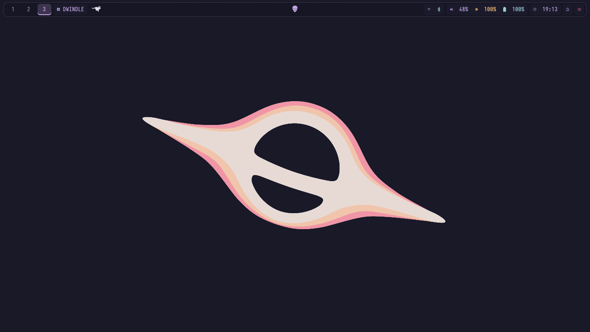
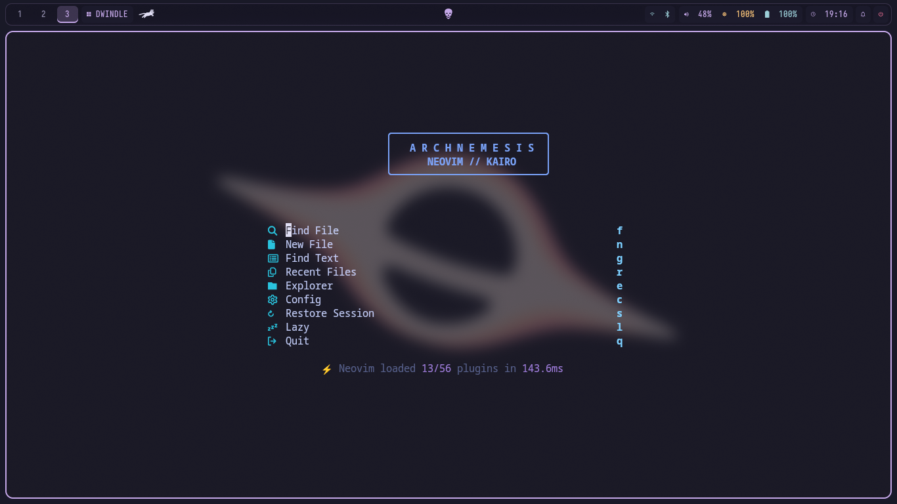
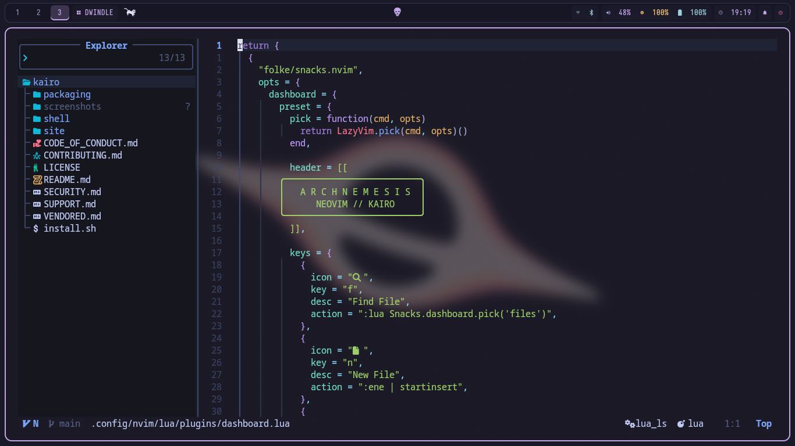
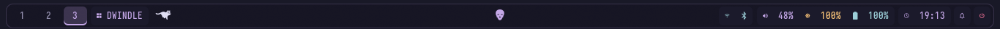
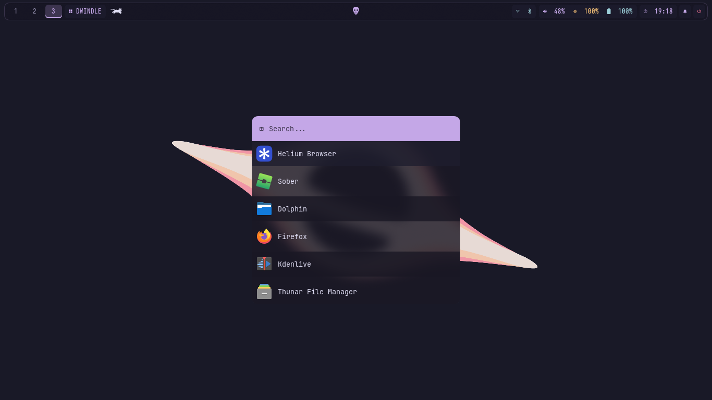
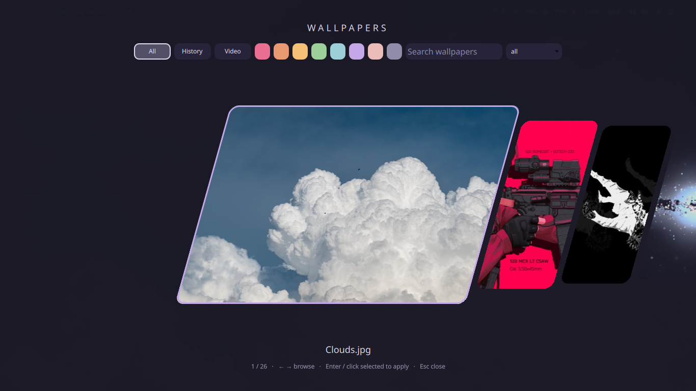
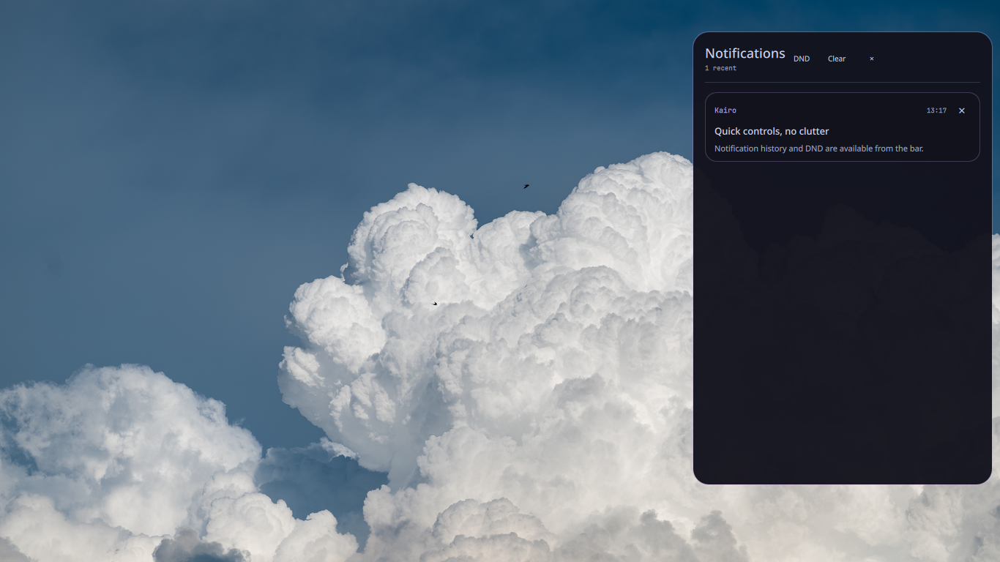
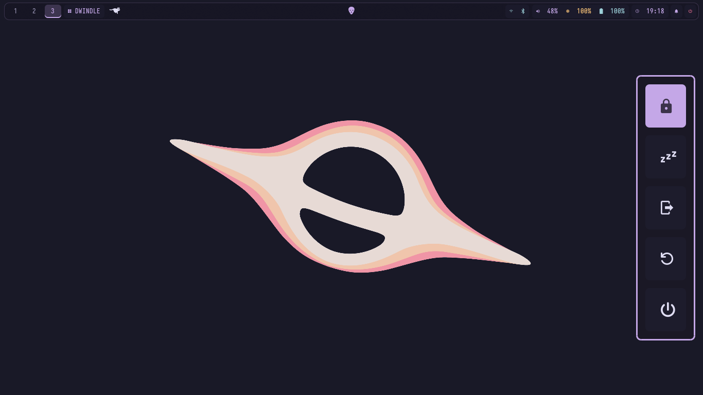
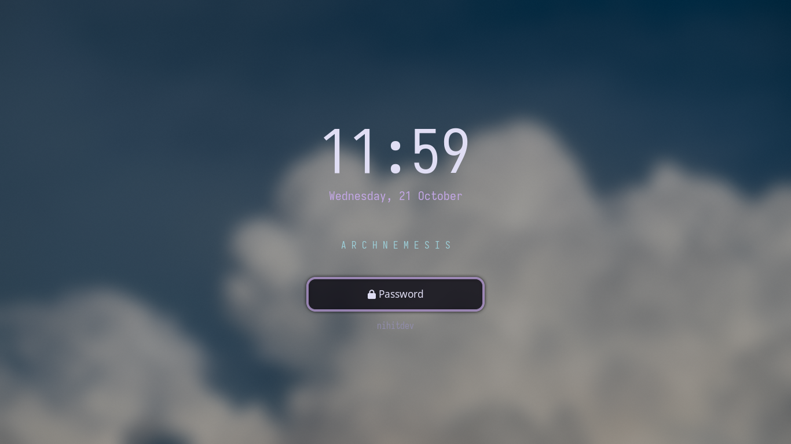
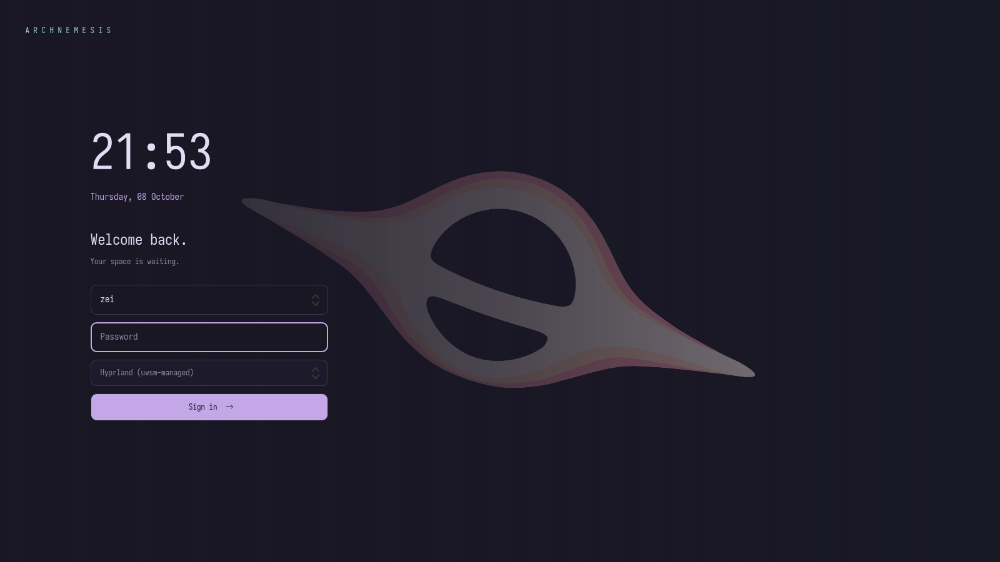

<div align="center">

# Kairo

### Arch, composed.

**A safe, interactive workstation installer for Arch Linux, Hyprland, and a CLI-first development setup.**

[](https://archlinux.org/)
[](https://get-kairo.vercel.app)
[](install.sh)
[](LICENSE)

[Website](https://get-kairo.vercel.app) · [Quick start](#quick-start) · [Screenshots](#screenshots) · [Features](#features) · [Modules](#included-configurations) · [Safety](#safety-first)

</div>

Kairo turns a fresh Arch installation into a configured development workstation without assuming your home directory is disposable.

It combines curated dotfiles, optional package installation, developer toolchains, GPU detection, and a dependency-free terminal UI. Changes are staged before activation, existing configuration can be backed up, and failed transactions roll back instead of leaving half-installed state behind.

> **Preview first. Install second.** `./install.sh --dry-run` performs a zero-write preview of the selected changes.

## Features

- **Interactive installer** — full-screen Bash TUI using standard terminal sequences
- **Selective deployment** — install only the dotfile modules and toolchains you want
- **Arch-native packages** — `pacman` first, with optional Paru or Yay for AUR packages
- **Transactional changes** — staged replacements, private backups, validation, and rollback
- **GPU detection** — reviewed package proposals for Intel, AMD, and modern NVIDIA hardware
- **Developer profiles** — Rust, Python, web, C/C++, containers, Wayland, and media tooling
- **Per-shell prompts** — separate Starship configuration for Bash, Fish, Nushell, and Zsh
- **Curated rice branches** — coordinated Hyprland, Waybar, Kitty, and wallpaper palettes
- **Automation-friendly output** — deterministic plain output outside interactive terminals
- **No surprise upgrades** — Kairo installs what you selected without silently upgrading the whole system

## Quick start

### Remote installer

```sh
curl -fsSL https://raw.githubusercontent.com/nihitdev/kairo/main/install.sh | bash
```

or:

```sh
wget -qO- https://raw.githubusercontent.com/nihitdev/kairo/main/install.sh | bash
```

The remote entry point requests sudo when required, clones Kairo to `~/kairo`, and launches the interactive installer. If a clean checkout already exists, it is updated with a fast-forward pull. Modified or unrelated directories are not overwritten.

### Clone manually

```sh
git clone https://github.com/nihitdev/kairo.git
cd kairo
./install.sh
```

Want to inspect everything before Kairo writes anything?

```sh
./install.sh --dry-run
```

---

## Bootable Arch USB

Build a USB-flashable **Arch Linux Kairo install medium** from the official Arch
ISO with `./iso/build.sh`. The image uses the standard `archinstall` guided
installer and bundles Kairo into the installed system. After reboot, run
`kairo-setup` as your regular user to select and install the dotfiles and packages.
Internet access is required. See the [ISO build and USB guide](iso/README.md)
for dependencies, checksum verification, flashing, and installation steps.

### Automated ISO builds and releases

[](https://github.com/nihitdev/kairo/actions/workflows/build-iso.yml)

Every push to `main` builds the Arch ISO and updates the single **Kairo Rolling ISO** release at tag `rolling`. The raw `.iso` and its `.sha256` checksum are direct assets on the [GitHub Releases page](https://github.com/nihitdev/kairo/releases). Builds triggered by `iso-v*` tags continue to publish versioned releases. Failed builds do not publish. Images at or above GitHub's 2 GiB per asset limit fail clearly; they are never split or archived.

Download both rolling assets and verify the ISO before flashing:

```sh
gh release download rolling --repo nihitdev/kairo \
  --pattern 'kairo-arch-*.iso' \
  --pattern 'kairo-arch-*.iso.sha256'
for checksum in kairo-arch-*.iso.sha256; do sha256sum -c "$checksum"; done
```

The checksum command matches the current ISO checksum. For a versioned release, replace `rolling` with its `iso-v*` tag. See [the ISO guide](iso/README.md) for USB flashing and installation.

## Screenshots

**ARCHNEMESIS on Hyprland** — nine captures of the desktop and its daily workflows. Click a section to expand or collapse it.

<details open>
<summary><b>Desktop — the full setup</b></summary>



Dark wallpaper, compact spacing, and the Rosé Pine Waybar.

</details>

<details>
<summary><b>Neovim — startup dashboard & editor</b></summary>

**Startup dashboard** · What you see when running `nvim` without a file.



**Editor** · Lua syntax highlighting, Snacks explorer, and the matching status line.



</details>

<details>
<summary><b>Waybar — workspaces & desktop controls</b></summary>



Workspaces, layout indicator, skull/cat artwork, hardware controls, notifications, and power.

</details>

<details>
<summary><b>Rofi — application launcher</b></summary>



**Super + Space** opens the compact application launcher.

</details>

<details>
<summary><b>Wallpaper picker — thumbnail gallery</b></summary>



**Super + Alt + Space** opens the standalone Quickshell wallpaper carousel with
slanted previews, local search, colour filters, history, and monitor selection.
Use the arrow keys or scroll to browse, then Enter to apply. The picker closes
automatically after a successful selection; Escape closes without applying.
The screenshot above shows the original Rofi gallery, still available with
`~/.config/hypr/scripts/wallpaper-picker.sh --rofi`.

</details>

<details>
<summary><b>Notifications — SwayNC panel</b></summary>



Notification history and Do Not Disturb, opened from Waybar.

</details>

<details>
<summary><b>Session — power menu & lock screen</b></summary>

**Power menu** · Lock, suspend, logout, reboot, and shutdown.



**Lock screen** · Wallpaper-aware Hyprlock, clock, and matching accents.



</details>

Screenshots may show wallpapers outside the curated collection bundled with the installer.

---

## Installer flow

```text
Welcome → Detect → Dependencies → Modules → Review
        → Backup → Packages → Dotfiles → Configure → Validate → Complete
```

Kairo detects the distribution, architecture, shell, display session, package tools, service manager, and configuration root. The review step shows the selected modules, missing packages, replacement targets, and backup behavior before privileged or destructive work begins. Use arrow keys or Page Up/Page Down
to scroll the review; Enter accepts it and Q/Escape cancels.

| Key | Action |
| --- | --- |
| `↑` / `↓` or `J` / `K` | Move |
| `Space` | Toggle item |
| `A` | Select all |
| `N` | Select none |
| `Enter` | Continue |
| `Q` or `Esc` | Cancel safely |

## Common commands

```sh
# Preview one module
./install.sh --dry-run --only starship

# Install selected modules
./install.sh --only yazi --only broot --only starship

# Select every supported dotfile module
./install.sh --only all

# Install missing packages for selected modules
./install.sh --install-packages --only nvim --only yazi

# Add development toolchains
./install.sh --install-packages \
  --profile core-build \
  --profile rust \
  --profile web

# Use Yay instead of the default Paru helper
./install.sh --install-packages --aur-helper yay

# Review and install detected GPU drivers
./install.sh --install-packages --install-gpu-drivers

# Explicitly disable backups
./install.sh --no-backup --only starship
```

The interactive installer asks which login shell to use: **keep current** (the
default), Bash, Zsh, Fish, or Nushell. Installing shell configs does not implicitly
change your login shell. For command-line installation:

```bash
./install.sh --dry-run --only zsh --default-shell zsh
./install.sh --no-backup --install-packages --only fish --default-shell fish
./install.sh --only nushell --default-shell nu
```

`--install-packages` includes a missing selected shell even if its config module is
not selected. The installer checks `/etc/shells` and runs `chsh` for the current
user only, after the configuration transaction succeeds. Authentication may be
required. Log out and back in afterward; terminal-specific shell overrides can
still take precedence. `--default-shell keep` never calls `chsh`.

Run `./install.sh --help` for the authoritative list of options, modules, and profiles.

## Included configurations

| Area | Modules |
| --- | --- |
| Shells | [Bash](.config/bash/), [Fish](.config/fish/), [Nushell](.config/nushell/), [Zsh + Oh My Zsh](.config/zsh/) |
| Prompt & history | [Starship](.config/starship/), [Atuin](.config/atuin/), [Oh My Posh](.config/oh-my-posh/) |
| CLI workflow | [Bat](.config/bat/), [Broot](.config/broot/), [Yazi](.config/yazi/), [LazyGit](.config/lazygit/), [Fastfetch](.config/fastfetch/), [Btop](.config/btop/), [Cava](.config/cava/) |
| Development | [Git](.config/git/), [Neovim](.config/nvim/), [SSH](.config/ssh/) |
| Desktop | [WezTerm](.config/wezterm/), [Kitty](.config/kitty/), [Hyprland](.config/hypr/), [Waybar](.config/waybar/), [Kairo Shell](#kairo-shell) |

Every module is selected by default except **Kairo Shell**. This applies to both
the interactive module picker and CLI runs without `--only`. Deselect modules in
the menu or use `--only NAME` for a scoped installation. Preview changes first,
especially when replacing compositor configuration:

```sh
./install.sh --dry-run --only hypr
```

Third-party snapshots and intentionally duplicated assets are documented in [VENDORED.md](VENDORED.md).

### ARCHNEMESIS SDDM login theme

The matching [SDDM theme](.local/share/sddm/themes/archnemesis/README.md) includes
Rosé Pine colors, Iosevka, the black-hole wallpaper, a user dropdown, a session
picker, and power controls. Assets are bundled so the greeter does not need access
to your home directory.



```bash
# Select SDDM from the interactive module menu, or use the CLI
./install.sh --dry-run --only sddm
./install.sh --only sddm --install-packages

# Preview without logging out, then inspect and install system-wide
./.local/share/sddm/themes/archnemesis/preview.sh
./.local/share/sddm/themes/archnemesis/install.sh --dry-run
./.local/share/sddm/themes/archnemesis/install.sh
```

SDDM is selected by default and can be deselected in the interactive
menu or installed separately with `--only sddm`. Usernames come from SDDM’s system account model, not
a configured username. The module saves the previous theme and SDDM settings
and prints a rollback command. Its system backup is kept even with `--no-backup`.
It does not enable SDDM,
change your display-manager service, or restart your session. If SDDM is already
your display manager, the theme appears the next time its greeter starts.

### ARCHNEMESIS desktop installation

The Hyprland and Waybar payloads track the live desktop: a floating transparent bar,
wallpaper-derived colors, Dwindle/Scrolling/Master switching, event-driven
notifications, and CPU-reactive cat artwork. The original workspace, media, launcher, lock, and wallpaper
shortcuts are preserved. These Lua configs target Hyprland 0.56 or newer.

**Super+L** (or the Waybar layout button) cycles Dwindle → Scrolling → Master.
Master gives the main window 60% of the width and stacks other windows on the right.
The selected layout persists. **Super+/** opens the searchable shortcut reference;
**Super+Shift+R** validates and reloads the compositor configuration.

The desktop uses subtle opening animations, quicker closing/fades, a 32px transparent
Waybar with dot workspaces and centered media, and a compact 400px Rofi launcher. Wi-Fi
and Bluetooth icons reflect live connection status. Window controls include
**Super+F** for fullscreen, **Super+Shift+Space** for floating,
**Super+Shift+Arrows** to move, and **Super+Ctrl+Arrows** to resize.
**Ctrl+Print** saves and copies the active window rectangle.

```bash
# Preview the complete desktop (no writes or package installation)
./install.sh --dry-run --only hypr

# Install the desktop plus its runtime tools; skip persistent backups if desired
./install.sh --no-backup --install-packages --only hypr

# Update only Waybar and its bundled artwork fonts
./install.sh --dry-run --only waybar
./install.sh --no-backup --only waybar
```

`hypr` includes Waybar, Hyprlock, and SwayNC. It seeds the custom Rofi setup only
when no Rofi directory exists; select `--only rofi` explicitly to replace one.
Kairo Shell takes precedence over Waybar when both are selected. Its startup
command lives in an installer-generated `hypr/config/bar.lua`, avoiding edits to
the daemon list. Installing only Waybar expects the matching Hyprland/Rofi scripts
to already be present for its click actions.

Waybar's text, accents, workspace highlights, and hover colors follow the selected
wallpaper. Both static pickers, the live-wallpaper picker, and login startup call
`waybar/scripts/wallpaper-colors.py`; no polling daemon is used. Static images are
sampled with Python Pillow; video wallpapers use one FFmpeg frame. A crop of the
wallpaper's top strip guides contrast. The stylesheet imports `colors.css`, which
is replaced atomically and Waybar reloads only when the palette changes.

The installer includes Pillow, FFmpeg, and JetBrains Mono with Waybar. It samples
an existing wallpaper into a staged payload with `--no-reload`, preserving the
running session. A bundled palette for `snow-pine-forest.png` keeps fresh installs
usable even when sampling dependencies or a readable wallpaper are unavailable.

SwayNC is also a default module (`--only swaync` for a scoped install). It deploys
`config.json` and `style.css` individually, preserving other files in the SwayNC
directory. The ARCHNEMESIS glass theme retains grouped notifications, DND and
critical styling. Normal notifications expire after 7 seconds, low-priority ones
after 4 seconds, and critical notifications remain until dismissed. The existing
Hyprland layer rules provide blur for the control center and floating popups.

The same module installs `~/.local/bin/battery-guardian`. Hyprland starts it on
login; a process lock prevents duplicate watchers. It checks the battery every
15 seconds, warns once at 20%, 10% and 5%, and resets warnings when charging.
BAT1 is preferred with automatic fallback to other BAT devices; desktops without
a battery exit without starting a watcher. Dependencies are `swaync`, `libnotify`
and `util-linux`. To deploy only these managed files without backups:

```sh
./install.sh --only swaync --no-backup
```

The installer deploys Waycat and Skulltype into the user's XDG font directory and
refreshes that directory's font cache. `--install-packages` includes Iosevka Nerd
Font, Hyprpaper/Hypridle/Hyprlock, SwayNC, and the TUI tools used by the bar. It does
not automatically install every application mentioned in personal keybinds.

The repository bundles exactly 25 curated wallpapers: the 18 images from
**CozyPixels / Catppuccin / Space & Cosmic** and four downloaded snow scenes
(`snow-pine-forest.png`, `snow-night-moon.png`, `snow-desert-sunset.jpg`, and
`snow-mountain-range.jpg`), plus `Clouds.jpg`, `Girl-Shooter.png`, and
`Mahoraga.jpg`. Hyprland installation copies the images directly into
`~/Pictures/Wallpapers`, with no nested folders, Nord/One Dark collections, or
preview READMEs. It does not clone CozyPixels or replace existing personal files. A fresh install
selects **snow-pine-forest.png**; reinstalls preserve an existing wallpaper link or
saved selection. Machine-specific wallpaper links remain excluded from Git.

Both static wallpaper pickers scan `~/Pictures/Wallpapers` recursively.
Use **Super+Alt+Space** to choose one. **Super+Ctrl+Space** opens the separate
live-wallpaper picker for videos in
`~/Pictures/CozyPixels/Live Wallpapers/Wallpapers`. Hyprland restores the selected
wallpaper backend at startup; `--install-packages` includes Quickshell, Qt Quick,
Python Pillow, FFmpeg, and the AUR package `mpvpaper`.
Pass `--install-wallpapers` to install the curated collection with other modules,
without selecting Hyprland. Wallpaper copies participate in transactional rollback.
The picker updates Hyprpaper's persistent selection. Locking falls back to a solid
background when no image is available. Desktop launchers use the standard
`~/.config` layout; use that location for the complete desktop installation.

Desktop source syntax and destinations are checked before package installation or
configuration replacement. The installer does not restart the compositor, bar,
or session services. Review the result and reload them when ready.

A remote `--dry-run` prints bootstrap guidance without cloning, updating, invoking
sudo, or changing `~/kairo`. Use an existing checkout for the detailed install plan.

Kitty seeds `user.conf` on first installation and preserves existing overrides
on subsequent installs. It loads those overrides after the managed settings.

## Kitty Smooth

**Kitty Smooth** is selected by default in the Desktop module group. Deselect it
to skip the patched build, or install it separately with:

```sh
./install.sh --dry-run --only kitty-smooth
./install.sh --only kitty-smooth --install-packages --no-backup
# Also deploy the modular Hyprland shortcuts:
./install.sh --only kitty-smooth --only hypr --install-packages --no-backup
```

This optional component builds [SunqdXX/kitty-smooth-cursor](https://github.com/SunqdXX/kitty-smooth-cursor)
and leaves pacman's Kitty intact. It installs the patched build to
`~/.local/kitty-smooth`, its launcher to `~/.local/bin/kitty-smooth`, and a
**Kitty Smooth** desktop entry in `${XDG_DATA_HOME:-~/.local/share}/applications`.
It includes the normal Kitty config module. Existing `user.conf` preferences
are preserved except for the six cursor settings below; themes, fonts,
transparency, splits, and other keybindings remain unchanged.

```conf
cursor_trail 0
cursor_smooth_motion yes
cursor_smooth_motion_factor 0.2
cursor_smooth_motion_spring 0.8
cursor_smooth_motion_max_stretch 3 2
cursor_smooth_motion_antijitter 50
```

The shared `kitty.conf` also disables `cursor_trail`. Stock Kitty ignores the
patch-specific options (it may log unknown-key warnings). Hyprland's Lua
`programs.lua` uses the launcher when present and otherwise uses `kitty`;
`SUPER+Return` and `SUPER+N` still use `P.terminal` and `P.editor`. The launcher
itself falls back to stock Kitty if the patched binary has been removed. Reload
Hyprland after installing or removing the launcher so Lua selects it again.

Kairo does **not** run upstream's installer. It pins Kitty **v0.49.2** at
`b2cb871254fbdac19a085188813c8dfb258b95cd` and the patch at
`7a12c832f11bdf10edd4280f1e4f3cd750210a0e`, verifies the source commit and patch
SHA-256, checks patch application, and builds in a temporary directory before
transactional deployment. `--install-packages` supplies the build libraries,
Go, Python, compiler, `shader-slang`, and `ttf-nerd-fonts-symbols-mono` through
Arch's package manager. Go may fetch the source's checksum-verified module
dependencies. No compiler or font archives are fetched by Kairo. The build
needs network access, several minutes, and sufficient disk space and memory.
HTML/man documentation generation is skipped, as in upstream's installer.

**Updating:** pull Kairo updates and rerun the install command. This rebuilds the
reviewed pinned version; it does not silently track the newest Kitty release.
Maintainers updating the pins in `install.sh` must review the patch, update its
SHA-256, and validate the build before publishing the change. Distribution
library upgrades may also require rebuilding. Repeat installations reuse a build
with matching pins; use `--rebuild-kitty-smooth --only kitty-smooth` to force a rebuild. `--no-backup` avoids permanent
backups while retaining automatic rollback of failed configuration deployment.

**Uninstalling:** remove only the patched build and its launcher/menu entry:

```sh
rm -rf -- "$HOME/.local/kitty-smooth"
rm -f -- "$HOME/.local/bin/kitty-smooth"
rm -f -- "${XDG_DATA_HOME:-$HOME/.local/share}/applications/kitty-smooth.desktop"
```

Reload Hyprland to select stock Kitty. You may remove the five
`cursor_smooth_motion*` lines from your Kitty `user.conf` to silence stock-Kitty
warnings. Keep `cursor_trail 0` or restore your preferred stock trail setting.
The shared Kitty configuration and pacman package are retained.

Validation: `python3 .config/tests/test-kitty-smooth.py` exercises staged builds
with mocked upstream tools, failure recovery, preference preservation, desktop
entry generation, and both fallback paths. A complete source build and visual
cursor/Rofi checks still need testing on the target Arch desktop.

## WezTerm

WezTerm is selected by default and is available in the interactive module picker
and through `--only wezterm`:

```sh
# Preview the configuration deployment
./install.sh --dry-run --only wezterm

# Install the configuration and missing Arch dependencies
./install.sh --install-packages --only wezterm
```

The installer deploys the complete [modular configuration](.config/wezterm/)
to `~/.config/wezterm` (or `$XDG_CONFIG_HOME/wezterm`) using Kairo's transactional
copy, backup, and rollback workflow. Package installation includes `wezterm`,
`zsh` for the configured default shell, and `ttf-jetbrains-mono-nerd` for the font
and UI icons. Packages are only installed with `--install-packages` or when
selected during interactive review.

The configuration retains the 9.75 font size, custom tab bar, left-click new-tab
action, right-click launch menu, colours, keybindings, and status modules.
Personal backdrop images are excluded; the background colour works without
images. To use your own wallpapers, set an external directory with
`set_images_dir` in [wezterm.lua](.config/wezterm/wezterm.lua), before
`scan_images_dir`. An external directory keeps images outside the managed
configuration that the installer replaces.

If `~/.wezterm.lua` exists, Kairo skips WezTerm deployment and reports the
conflict. Move that file aside before installing the XDG configuration.
Upstream attribution and the retained MIT license are documented in
[VENDORED.md](VENDORED.md#wezterm).

## Kairo Shell

The optional `kairo-shell` module installs Kairo Shell `v2.2.0-beta.1`, verified
against commit `64420cb38748b406608af95b2252f60958a8e5a9`. It is unselected by
default; `--only all` includes it.

```sh
# Preview the shell and Hyprland startup integration
./install.sh --dry-run --only hypr --only kairo-shell

# Install the shell, Hyprland configuration, and required packages
./install.sh --install-packages --only hypr --only kairo-shell
```

Selecting both modules writes a managed bar override with the installed
`kairod start` path and skips Waybar deployment. Selecting
only `hypr` continues to install Waybar. Selecting only `kairo-shell` installs
the shell without changing Hyprland; start it with `~/.local/bin/kairod start`
in a Hyprland session. Installation does not start a daemon or change an active
session.

The installer manages these paths with its normal backup and rollback workflow:

- Application: `${XDG_DATA_HOME:-~/.local/share}/kairo`
- Launchers: `${KAIRO_BIN_DIR:-~/.local/bin}/{kairo,kairod}`
- Settings: `${XDG_CONFIG_HOME:-~/.config}/kairo/settings.json` (created only when absent)
- Version state: `${XDG_STATE_HOME:-~/.local/state}/kairo/version`
- Desktop entry and icon under the XDG data directory

All destinations must resolve inside your home directory. Existing unrelated
launcher files and unmanaged application directories are rejected. Put the
launcher directory first in your session's `PATH`; its `kairo` command controls
the desktop shell. Use `./install.sh` from this checkout for the dotfile installer.

Runtime dependencies from the pinned release are included in Kairo's package
review, including Quickshell, Hyprland, Qt, audio/network utilities, the Iosevka
Nerd Font, and the AUR package `wl-gammarelay-rs`. Installation remains opt-in
through `--install-packages` or interactive review. Without it, missing packages
are reported and must be installed before starting the shell. The upstream
interactive installer, system upgrades, display-manager setup, service changes,
and wallpaper installation are not run.

The downloaded payload retains upstream AGPL-3.0 licensing and attribution.
The [local shell prototype](shell/README.md) is separate from this release.

## Developer toolchains

Profiles are independent from dotfile modules. Repeat `--profile` to combine them, or use `--profile all`.

| Profile | Included tools |
| --- | --- |
| `core-build` | Base development tools, Git, curl, wget, rsync, archives, jq, ShellCheck |
| `cpp` | GCC, Clang, CMake, Ninja, Meson, GDB, LLDB |
| `rust` | Rustup |
| `python` | Python, pip, uv |
| `web` | Node.js, npm, pnpm, Bun |
| `containers` | Docker, Docker Compose, Podman, Buildah |
| `wayland` | Portal, clipboard, screenshot, brightness, media, and DDC tooling |
| `media` | PipeWire, WirePlumber, FFmpeg, ImageMagick, yt-dlp |

## Package management

Package installation is opt-in through `--install-packages` or the interactive review. Kairo checks what is already installed and only requests packages required by the selected modules and profiles.

- Official packages are grouped into `sudo pacman -S --needed ...`.
- AUR packages use Paru by default or Yay with `--aur-helper yay`.
- AUR helpers run as the current user, never through `sudo`.
- A missing helper can be bootstrapped from its official AUR PKGBUILD.
- Kairo does not perform a surprise full-system upgrade.

Zsh uses the modular ARCHNEMESIS configuration, with syntax highlighting loaded
last and Forgit configured to preserve existing aliases. With package installation
enabled, missing fzf-tab, autopair, You Should Use, and Forgit plugins are installed
at the pinned revisions from the working setup. Existing plugin installations are
preserved.

Fish is an optional interactive shell alongside Zsh. Its ARCHNEMESIS environment,
aliases, helper functions, colors, and mise/zoxide/direnv/Starship integrations use
Fish-native suggestions, syntax highlighting, and completions; no Fisher plugins
are installed. Selecting Fish does not change the login shell. Scoped Zsh/Fish
installs seed their existing Starship prompt configuration only when absent.
Both shells expose Fastfetch through aliases, without running it during startup.

For Neovim, Kairo can bootstrap `lazy.nvim` and perform a headless LazyVim sync using the tracked `lazy-lock.json`. Without package installation, LazyVim performs its normal bootstrap when Neovim first starts.

Privileged work is requested only after review and before filesystem changes begin.

### Optional Chaotic-AUR support

[Chaotic-AUR](https://github.com/chaotic-aur) is treated as a separate trust decision:

```sh
./install.sh --dry-run --enable-chaotic-aur --profile web
./install.sh --enable-chaotic-aur --profile web
```

Kairo imports and locally signs the published key, installs the signed keyring and mirror list, backs up `/etc/pacman.conf`, and adds the repository idempotently. If the later transaction fails, the original Pacman configuration is restored.

## GPU drivers

With `--install-gpu-drivers`, Kairo inspects graphics controllers and proposes an Arch package set for review.

| Hardware | Proposed stack |
| --- | --- |
| AMD | Mesa and RADV Vulkan |
| Intel | Mesa, Intel Vulkan, and Intel media drivers |
| Modern NVIDIA | Open kernel modules, utilities, VA-API bridge, and matching installed-kernel headers |

Mixed Intel/AMD systems receive both applicable userspace stacks. Legacy or unclassified NVIDIA hardware produces a warning rather than a guess. Kairo does not generate an Xorg configuration or require Hyprland to be running.

## Rice branches

Each curated desktop palette lives on a `rice/*` Git branch and coordinates the relevant Kitty, Waybar, Hyprland, and wallpaper configuration.

| Family | Branches |
| --- | --- |
| Classic terminal | `rice/campbell`, `rice/vintage` |
| One Half | `rice/one-half-dark`, `rice/one-half-light` |
| Tango | `rice/tango-dark`, `rice/tango-light` |
| Catppuccin | `rice/catppuccin-latte`, `rice/catppuccin-frappe`, `rice/catppuccin-macchiato`, `rice/catppuccin-mocha` |
| Rosé Pine | `rice/rose-pine`, `rice/rose-pine-moon`, `rice/rose-pine-dawn` |

Switching rice is an ordinary Git workflow:

```sh
cd ~/kairo
git fetch origin
git switch rice/catppuccin-mocha

./install.sh --dry-run --only hypr --only kitty
./install.sh --only hypr --only kitty
```

`main` remains the stable development branch. Switching branches changes the configuration available to the installer; Git does not modify files already deployed under `~/.config`.

Kairo backs up replaced destinations unless `--no-backup` is explicitly supplied.

## Per-shell Starship

Kairo uses one Starship binary with a separate configuration for each shell:

```text
~/.config/starship/
├── bash.toml
├── fish.toml
├── nushell.toml
└── zsh.toml
```

`STARSHIP_CONFIG` selects the appropriate file. The installer manages the complete Starship directory rather than using a single root-level prompt configuration.

## Safety first

Kairo is designed to make workstation setup repeatable without turning configuration replacement into a gamble.

- Existing destinations are backed up under private, unique `~/.dotfiles-backup/YYYYMMDD-HHMMSS.xxxxxx/` directories.
- Replacement payloads are staged before activation.
- Failed operations restore replaced destinations and remove newly created partial targets.
- `/`, `$HOME`, the configuration root, traversal paths, symlink escapes, and destinations outside the home directory are rejected.
- `--dry-run` performs no writes, package changes, plugin installation, shell changes, or cache mutation.
- Repeated installations preserve unchanged payloads and avoid duplicate Git/SSH includes.
- Git identity, signing configuration, credentials, personal SSH material, `known_hosts`, and `authorized_keys` are not overwritten.
- `--no-backup` disables backup creation, not staging, destination validation, or rollback handling.

## Repository map

```text
kairo/
├── .config/
│   ├── bash/
│   ├── fish/
│   ├── nushell/
│   ├── zsh/
│   ├── starship/
│   ├── wezterm/
│   ├── scripts/
│   │   ├── install-ui.sh
│   │   └── validate_repo.py
│   └── tests/
├── shell/                    # Local Quickshell prototype
├── site/
├── install.sh
├── VENDORED.md
└── LICENSE
```

## Website development

The website at [get-kairo.vercel.app](https://get-kairo.vercel.app) lives in [`site/`](site/) and uses Vite with Tailwind CSS v4.

```sh
cd site
bun install
bun run dev
bun run build
```

pnpm is also supported:

```sh
pnpm install
pnpm dev
pnpm build
```

## Validation

```sh
bash -n install.sh
bash -n .config/scripts/install-ui.sh
./install.sh --dry-run
./install.sh --dry-run --only starship
./install.sh --dry-run --only yazi --only broot --only starship
./install.sh --dry-run --only hypr --only kairo-shell
python3 .config/scripts/validate_repo.py
./.config/tests/test-install.sh
```

The Linux test suite covers normal and repeated installation, dry-run immutability, component selection, backup and no-backup modes, Git and SSH include deduplication, shell-specific Starship paths, rollback, remote bootstrap, non-interactive execution, terminal input handling, and Kairo Shell deployment, preservation, release verification, and rollback.

## Community

See [Contributing](CONTRIBUTING.md) for development and pull request guidance,
[Support](SUPPORT.md) for help and bug reports, [Security](SECURITY.md) for
vulnerability reporting, and the [Code of Conduct](CODE_OF_CONDUCT.md) for
community expectations.

## License

Released under the terms of [LICENSE](LICENSE).

### Plymouth boot theme

The optional **Plymouth Lone** System module installs the bundled Lone boot
animation. Select it in the module picker or use
`./install.sh --only plymouth --install-packages`. See the
[Plymouth setup notes](.local/share/plymouth/README.md) for boot prerequisites.
